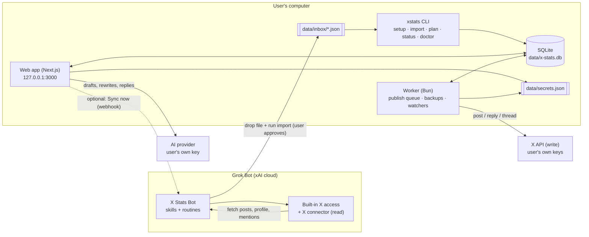
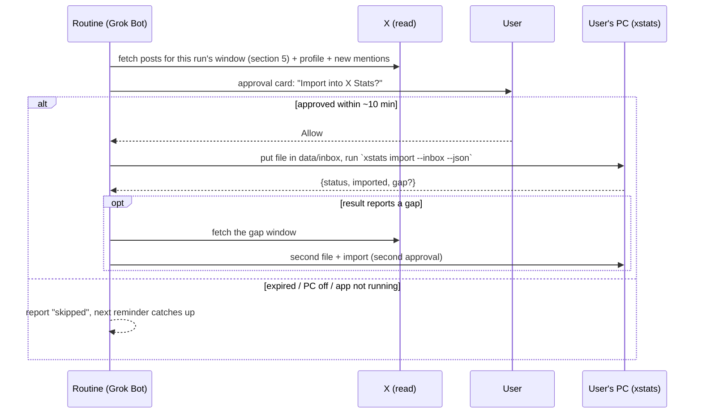

# X Stats: Architecture Plan

A local-first X growth app (SuperX-style) that each user installs once on their own computer.
**Grok Bot** installs it, reads X data for it and keeps it fresh. The user's own keys are used
only to **post to X** and to **generate AI text**.

> Status: draft v1 (24 Oct 2026). Sections marked **Spike** are unverified assumptions to test
> before building on them. Facts about Grok Bot and the X API come from their docs as of Oct 2026
> (sources at the end).

---

## 1. Decisions already made

| # | Decision |
|---|---|
| D1 | One-time install. The app and its database run on the user's computer. No hosted backend of ours. |
| D2 | Grok Bot (x.ai/bot) installs and sets up the app, then does **all reading from X** through its built-in X access and X connector. |
| D3 | Reads use Grok Bot's free X read allowance, which resets. We stay under it by fetching only what's needed (see section 5). |
| D4 | First import fetches the **last 3 months** by default. |
| D5 | Several Grok Bot reminders (routines) run per day. Each one asks the user to approve the local step. A missed or unapproved reminder is caught up by the next one that runs. |
| D6 | The user's **X API keys** are used only to post (posts, replies, threads). The user's **AI key** is used only for AI writing. |
| D7 | Users are expected to already have a paid Grok plan that includes Grok Bot. |

## 2. Principles

1. **The local database is the source of truth.** Grok Bot never edits it directly. It drops files that the app validates and imports.
2. **Running twice is always safe.** Imports update existing rows instead of adding duplicates, so a repeated or overlapping reminder costs reads but never corrupts data.
3. **Keys never leave the machine.** The user types them into the local app, never into the Grok Bot chat.
4. **Nothing is posted without the user's approval.** This applies to AI output and to automations by default.
5. **Show money before spending it.** Every X write and AI call shows an estimated cost and is logged.
6. **Never pretend data is fresh.** The UI always shows "Last synced …" and why a sync failed.

---

## 3. System overview



### Components

| Component | What it is | Runs |
|---|---|---|
| **Web app** | The current Next.js 16 app, extended: dashboard, posts, compose, queue, replies, insights, settings, setup wizard. Listens on `127.0.0.1` only. | While the computer is on (autostart at login) |
| **Worker** | A long-running Bun process: publishes scheduled posts, imports anything in the inbox, takes daily backups, flags missed posts. | Same as the web app, started by the same launcher |
| **`xstats` CLI** | Bun commands that Grok Bot and the user run: `setup`, `import`, `plan`, `status`, `doctor`, `update`, `autostart`. Every command has a `--json` flag so the bot can read the result. | On demand |
| **SQLite DB** | `data/x-stats.db`, via the existing libSQL client and Drizzle ORM | — |
| **X Stats Bot** | A Grok Bot shared as a **template link**: instructions, skills and routine setup. Templates don't carry code or scripts, so all logic lives in our app and CLI. | xAI cloud, plus approved steps on the user's computer |

---

## 4. Main flows

### 4.1 First install (run by Grok Bot)

1. The user opens our template link, clicks **Add to Grok Bot**, and asks it to "install X Stats".
2. The bot asks for the user's X handle and timezone and how many reminders a day they want (default 4).
3. The bot runs these on the user's computer, which the user approves:
   - install Bun if it's missing
   - download the latest release for this OS and verify its checksum
   - unzip it to the install folder (section 9)
   - `xstats setup --handle … --timezone …`: creates the data folders, runs migrations, saves settings
   - `xstats autostart enable`: starts the app at login (Task Scheduler on Windows, a LaunchAgent on macOS)
   - start the app and open `http://127.0.0.1:3000/setup`
4. In the browser, the user pastes their **X API keys** and **AI key** into the setup wizard. The bot never sees them.
5. **Backfill:** the bot fetches the last 90 days of the user's posts and profile, drops the files into the inbox and runs `xstats import --inbox --json`. Large backfills are split into files of at most 1,000 posts.
6. The bot creates the **routines** (section 6.3) and confirms the next run time.

### 4.2 Regular sync (each reminder)



- **Target: one approval per normal run.** A catch-up run needs at most two.
- The PC being off is not an error. The run is recorded as skipped, and the next run's window covers the gap because it starts from the **last successful** sync.

### 4.3 "Sync now" from the app (optional, Phase 2+)

Grok Bot routines can be triggered by a **webhook**: a POST with `Authorization: Bearer <key>` and a JSON body that the bot receives. The user pastes the routine's webhook URL and key into Settings. The **Sync now** button, and the app's startup check when the last sync is older than a set limit, then POST:

```json
{ "action": "sync", "mode": "light", "from": "2026-10-24T02:00:00Z", "reason": "user-click" }
```

The import step still needs the user's approval like any other run. A 200 response only means the run started, so the app polls `sync_runs` for the result.

### 4.4 Posting (user's X keys)

1. The user writes a post in **Compose**, alone or with AI help, and either posts now or schedules it.
2. The worker picks up posts that are due: it marks them `publishing`, calls `POST /2/tweets` and saves the returned id, setting `published`.
3. Threads are sent one part at a time, each part replying to the previous one (`reply.in_reply_to_tweet_id`). Quote posts use `quote_tweet_id`.
4. The new post is added to `posts` right away with zero metrics, and the next sync fills in the real numbers.
5. **Crash safety:** if the app dies while a post is `publishing`, it becomes `needs-check`. The next sync looks for a matching post (same text, posted after the attempt) before anything is retried, so nothing gets posted twice.

### 4.5 Missed scheduled posts

Grok Bot can't post to X, so scheduled posts only go out while the user's computer is on. **This is the main trade-off compared with SuperX, which posts from the cloud.**

- If the computer is on at the scheduled time, the post goes out on time.
- If the computer was off, on the next start any post that is late by **≤ 30 minutes** goes out automatically (a setting).
- Anything later is marked `missed`, and a banner asks "Post now / Reschedule / Discard".

---

## 5. Sync window rules (staying under the read limit)

All times are UTC in storage and the user's timezone in the UI. Names refer to `sync_state` (section 7).
The **app** decides the window. Each import returns a `next` block (section 6.3) that the bot
remembers and uses on its next run, so the bot never needs an extra approved command just to ask
what to fetch.

| Run type | When | Window | Approx. reads (this account: ~68 posts/day) |
|---|---|---|---|
| **Backfill** | First install, or after a gap > 90 days | last 90 days (setting: 30 / 90 / 180) | ~6,100 posts + 1 profile, once |
| **Full refresh** | First successful run of each local day | `from = min(now − 7d, last_ok_to − 1h)` | ~480 + 1 profile |
| **Light refresh** | Later runs the same day | `from = min(now − 24h, last_ok_to − 1h)` | ~70 + 1 profile |
| **Catch-up** | A run's import reports a gap | `[last_ok_to − 1h, start of this run's window]` | as needed, capped at 90 days |

- With the default of 4 reminders a day, that's roughly **700 reads a day** for this account (one full and three light runs). Lighter users need far fewer.
- Metrics on posts older than 7 days barely change, so they aren't refreshed by default. A **Refresh all** button reruns the 90-day backfill.
- **Reply-heavy accounts:** about 74% of this account's posts are replies. Setting `sync.refreshReplies = new-only` refreshes metrics for originals and quotes only, while still storing new replies. **Open question Q5.**
- **Partial runs:** if the bot hits its read limit mid-run, it still drops what it fetched with `"complete": false`. The import saves it, and the run is recorded as `partial`. `last_ok_to` only advances over windows that were fully covered, so the next run continues from there.
- **Fallback (Phase 2):** `xstats sync --source x-api` reads with the user's **own** X keys. Own-account reads cost **$0.001 per post** on X's pay-per-use plan, which is about $0.70 a day at the volumes above. It's off by default and offered when the Grok Bot limit keeps blocking syncs.

---

## 6. Grok Bot ↔ app contract

### 6.1 Folders

```
<data>/inbox/        bot drops files here (only place the bot writes)
<data>/processed/    imported files, kept 14 days
<data>/failed/       files that failed validation, with a matching .error.txt
```

File name: `<kind>-<UTC yyyyMMddTHHmmssZ>-<runId>.json`, e.g. `posts-20261024T083000Z-r8f2.json`.

### 6.2 Export envelope (version 1)

The bot writes **raw X API v2 objects** and doesn't reshape them. Every field mapping lives in our import code, so a smarter or dumber bot doesn't change the data.

```json
{
  "format": "xstats-export",
  "version": 1,
  "kind": "posts",
  "run": {
    "id": "r8f2",
    "type": "light",
    "trigger": "schedule",
    "source": "grok-bot-x-connector"
  },
  "fetched_at": "2026-10-24T08:30:12Z",
  "account": {
    "id": "2002000262127640576",
    "username": "designwkarthick",
    "public_metrics": {
      "followers_count": 0,
      "following_count": 0,
      "tweet_count": 0,
      "listed_count": 0
    }
  },
  "window": { "start_time": "2026-10-23T08:30:00Z", "end_time": "2026-10-24T08:30:00Z" },
  "complete": true,
  "rate_limited": false,
  "errors": [],
  "data": [
    {
      "id": "…",
      "text": "…",
      "created_at": "…",
      "conversation_id": "…",
      "in_reply_to_user_id": "…",
      "referenced_tweets": [{ "type": "replied_to", "id": "…" }],
      "public_metrics": {
        "impression_count": 0,
        "like_count": 0,
        "reply_count": 0,
        "retweet_count": 0,
        "quote_count": 0,
        "bookmark_count": 0
      }
    }
  ]
}
```

- `kind` is one of `posts | mentions | inspiration | account`.
- Posts are fetched with `GET /2/users/:id/tweets` using `tweet.fields=created_at,public_metrics,referenced_tweets,conversation_id,in_reply_to_user_id,lang` and `max_results=100`, following pages until the window is covered. Replies are included. Reposts can be excluded from the fetch, since the dashboard never counts them.

### 6.3 Import rules (`xstats import --inbox --json`)

1. Validate the envelope: `format`, `version`, size ≤ 20 MB, and `account.id` matches the configured user id. Anything else moves to `failed/` with the reason.
2. Upsert posts. The type and field mapping is today's `scripts/import-posts.ts` logic, moved into `lib/import/`. Never overwrite newer metrics with an older file.
3. Write a `post_metric_snapshots` row for each post whose numbers changed, and an `account_snapshots` row.
4. Rebuild `daily_stats` for the affected days.
5. Record a `sync_runs` row. Advance `sync_state.last_ok_to` only when the window is complete **and** its start is at or before the current `last_ok_to`, so there's no hole between them. Otherwise report the hole as `gap`.
6. Move the file to `processed/` and print the result for the bot:

```json
{
  "status": "ok",
  "run": "r8f2",
  "posts": { "received": 71, "new": 9, "updated": 62 },
  "gap": null,
  "next": { "type": "light", "from": "2026-10-24T07:30:00Z" }
}
```

`gap` is `{ "from": "…", "to": "…" }` when an earlier window was never covered, and the bot then runs a catch-up. `xstats plan --json` prints the same `next` block without importing anything, for the bot or for debugging.

### 6.4 The X Stats Bot (template)

**Instructions (the bot's standing rules):**
- Only write into `<data>/inbox/` and only run `xstats` commands on the user's computer.
- Never ask for, read or print keys, and never open `data/secrets.json`.
- Report failures. Never invent or reuse old data.

**Skills:**

| Skill | Does |
|---|---|
| `install-xstats` | Section 4.1 steps 2–6 |
| `xstats-backfill` | Fetch the 90-day window, in parts if large, then drop and import |
| `xstats-sync` | Use the `next` block from the previous import, kept in the bot's memory (if there is none, do a full refresh). Fetch posts + profile + mentions since the last mention id, drop and import, handle `gap`, then remember the new `next`. |
| `xstats-inspiration` *(Phase 5)* | Search X for the user's niche keywords and accounts (read from `xstats plan --json`), drop `inspiration` files |
| `xstats-update` | Run `xstats update` and report the version change |
| `xstats-doctor` | Run `xstats doctor --json` and explain any problem in plain words |

**Routines (created by the bot during install):**
- By default, `xstats-sync` runs at 08:00, 13:00, 18:00 and 22:00 in the user's timezone. The user can change this, and runs must be at least 5 minutes apart.
- Optional: an `xstats-sync` routine with a **webhook trigger** for the app's Sync now button (section 4.3).
- Routines may not be copied with the template. **Spike S3.** For that reason the install skill always creates them itself.

**Known Grok Bot behaviours to design around:**
- Approvals on runs the user didn't start (routines, webhooks) **expire after about 10 minutes**, and the action doesn't run. The next reminder catches up (D5).
- After a long absence, Grok Bot may **pause routines** until the user confirms. The app shows "Last synced 3 days ago. Open Grok Bot and resume X Stats routines."
- Routine runs use the user's weekly Grok Bot allowance. 4 runs a day is about 120 a month.
- Routine runs are limited to 200 per hour per routine and 300 per hour in total. Failed runs are not retried automatically.

---

## 7. Data model

The existing tables stay. New tables are added through Drizzle migrations.

| Table | Purpose | Key columns |
|---|---|---|
| `posts` *(exists)* | One row per post | add `account_id` (default: primary account) so multi-account later needs no data migration |
| `daily_stats` *(exists)* | Cached per-day totals derived from `posts` | unchanged |
| `accounts` | The connected X account (one in v1) | `id`, `username`, `name`, `avatar_url`, `is_primary` |
| `account_snapshots` | Follower growth | `account_id`, `taken_at`, `followers`, `following`, `posts_count`, `listed` |
| `post_metric_snapshots` | Metrics over time; enables **impressions gained per day** instead of today's "lifetime numbers summed on the day posted" | `post_id`, `taken_at`, `impressions`, `likes`, `replies`, `reposts`, `quotes`, `bookmarks` (only written when something changed) |
| `sync_runs` | History shown in Settings and used for debugging | `id`, `type`, `trigger`, `source`, `window_from`, `window_to`, `complete`, `status` (`ok/partial/failed/skipped`), counts, `error`, `file`, `started_at`, `finished_at` |
| `sync_state` | One row | `last_ok_to`, `last_full_refresh_day`, `backfill_done_at`, `last_mention_id` |
| `settings` | Non-secret settings (key/value JSON) | handle, user id, timezone, pay-period settings, reminder times, sync options, auto-post grace period |
| `drafts` | Compose, queue, history | `id`, `kind` (`post/thread/reply/quote`), `parts` (JSON), `in_reply_to_id`, `quote_id`, `scheduled_at`, `status` (`draft/scheduled/publishing/published/needs-check/missed/failed`), `published_ids`, `error`, `origin` (`user/ai`), `est_cost` |
| `mentions` | Replies inbox | post fields + `author`, `handled_at`, `reply_draft_id` |
| `inspiration_posts` | Viral posts in the niche (Phase 5) | post fields + `author`, `topic`, `saved` |
| `ai_generations` | AI usage and history | `kind`, `provider`, `model`, `input_tokens`, `output_tokens`, `est_cost`, `accepted` |
| `spend_ledger` | Every paid call | `provider` (`x/ai`), `operation`, `units`, `est_cost_usd`, `at` |

**Secrets** (`data/secrets.json`, created with user-only permissions):
- X: API key, API secret, access token, access token secret (OAuth 1.0a user context)
- AI: provider, API key, default model

Secrets are never sent to the browser. The UI only shows the last 4 characters.

---

## 8. App features (pages)

| Page | Status | Contents |
|---|---|---|
| `/` Dashboard | exists, extend | + follower growth (from snapshots), + impressions gained per day, + sync status chip ("Synced 2h ago · next 13:00") |
| `/posts` | exists | unchanged, plus a "Reply / Quote" action |
| `/compose` | new | editor with X character counting, thread builder, AI rewrite (hook, shorten, clarity), best-time suggestions, cost preview (**$0.015 per post, $0.20 if it contains a link**: warn about links), post now or schedule |
| `/queue` | new | drafts and scheduled posts as a list or calendar, missed-post banner, published history |
| `/replies` | new | mentions inbox, AI reply drafts in the user's voice, send with the user's keys |
| `/insights` | new | best time to post (weekday × hour heatmap from the user's own impressions), performance by post type and length, top themes |
| `/inspiration` | Phase 5 | the user's niche keywords and accounts, viral posts fetched by the bot, "Draft my version" |
| `/settings` | new | account, timezone, pay periods, keys, sync (reminder times, window options, run history, Grok Bot webhook), spend summary and optional monthly cap, backups |
| `/setup` | new | first-run wizard: keys → key check without posting (X: `GET /2/users/me`, about $0.01; AI: a tiny test prompt) → done |

### AI

- **Providers:** one small interface, `generate({ system, messages, maxTokens })`, with adapters for xAI, OpenAI, Anthropic and OpenRouter. The user picks one. A Grok subscription doesn't include xAI API credits, so the key is billed separately.
- **Voice profile:** built locally from the user's top ~30 original posts by engagement rate and reused as examples in every prompt. Rebuilt weekly.
- **Features:**
  - reply drafts, using the mention and its thread as context
  - rewrites
  - post ideas from top themes plus inspiration posts
  - turning a post into a thread
- **Guardrail:** AI output is always a **draft**. Post text read from X is untrusted input in prompts, so it can never cause an action by itself.

---

## 9. Install, run, update

| Topic | Plan |
|---|---|
| **Release** | GitHub Releases with a prebuilt Next.js `output: "standalone"` bundle **per OS/arch** (win-x64, mac-arm64, mac-x64, linux-x64), because libSQL ships a native binary. Each has a SHA-256 checksum. |
| **Runtime** | Bun, installed by the bot. Whether the standalone server runs under Bun on Windows is **Spike S6**; Node LTS is the fallback. |
| **Install folder** | Windows `%LOCALAPPDATA%\XStats\app`, macOS `~/Library/Application Support/XStats/app` |
| **Data folder** | Separate from the app (`…\XStats\data`) so updates never touch data. Set through `DATABASE_PATH` and `XSTATS_DATA_DIR`. |
| **Launcher** | `xstats start` runs the web server and the worker together, with a single-instance lock. `xstats autostart enable` registers it to start at login without admin rights. |
| **Updates** | `xstats update` downloads and verifies the new release, **backs up the DB**, swaps the app folder, runs migrations and restarts. Rolls back if migrations fail. |
| **Backups** | The worker copies the DB to `data/backups/` daily and keeps the last 7. |
| **Uninstall** | `xstats uninstall` removes autostart. Data is kept unless `--purge`. |

---

## 10. Security and privacy

- The server binds to **127.0.0.1** only. It rejects requests whose `Host` isn't `127.0.0.1:<port>` or `localhost:<port>`, which blocks DNS-rebinding attacks. Requests that change data must come from the same origin.
- Keys stay on the local machine (section 7). They are never logged, never written into export files and never pasted into the Grok Bot chat.
- Inbox files are **untrusted**: checked against a schema, size-limited and rejected on unknown versions.
- Automations (Phase 6) are opt-in, rate-limited, and follow X's automation rules. Auto-DM especially stays off by default.

---

## 11. What it costs the user

| Item | Cost | Notes |
|---|---|---|
| Grok Bot | User's existing Grok plan | Routines use the weekly Grok Bot allowance |
| Reading X | Free through Grok Bot's allowance (resets) | Fallback with own keys: $0.001 per own post read |
| Posting | **$0.015 per post**, **$0.20 if it contains a URL** | X pay-per-use. X gives $20 in credits after the first purchase. |
| AI | Provider token prices | Logged per call in `ai_generations` |

---

## 12. Roadmap

Each phase ends with something the user can run.

**Phase 0: Foundation (this repo)**
- `git init` and a first commit.
- Wire up `lib/config.ts`, which isn't imported anywhere and imports `DEFAULT_TIME_ZONE` and `isValidTimeZone`, which `lib/dates.ts` doesn't export. Then replace the hardcoded `@designwkarthick` (5 files) and IST (about 7 places) with settings.
- `settings` and `accounts` tables, plus `posts.account_id`.
- Fix the README, which still says replies are excluded and only the last 30 days are stored.
- **Done when:** the app works for any handle and timezone set in `settings`.

**Phase 1: Sync contract**
- Move the import logic to `lib/import/` and add the envelope v1 validator.
- `xstats` CLI: `setup / import / plan / status / doctor`.
- `sync_runs`, `sync_state`, `account_snapshots` and `post_metric_snapshots`.
- Sync status in the top bar and the Settings run history.
- **Done when:** dropping an envelope file in `inbox/` and running `xstats import --inbox --json` updates the dashboard and returns the correct `gap` and `next`.

**Phase 2: Grok Bot pack and local runtime**
- Run spikes S1–S6.
- Worker, launcher, autostart, per-OS release builds, `xstats update`.
- Bot instructions, skills and routines, published as a template link.
- Own-key fallback sync.
- **Done when:** on a clean Windows PC, the template link alone gets a user from nothing to a filled dashboard plus working routines.

**Phase 3: Compose and publish**
- Keys setup and key check.
- OAuth 1.0a signing and `POST /2/tweets`.
- Compose, threads, scheduling, queue, missed-post handling, crash safety (`needs-check`).
- Spend ledger and cap; best-time heatmap.
- **Done when:** a scheduled thread posts on time, and a post due while the PC was off is handled per section 4.5.

**Phase 4: AI writing and replies**
- Provider adapters and voice profile.
- Rewrite and post-idea tools in Compose.
- Mentions inbox with AI reply drafts.
- **Done when:** a mention fetched by the bot can be answered with an AI draft, edited and sent from `/replies`.

**Phase 5: Engage and inspiration**
- Niche setup and the `xstats-inspiration` skill and routine.
- `/inspiration` page.
- A "worth replying to" feed (recent, fast-rising posts from accounts in the user's niche).

**Phase 6: Automations (opt-in)**
- Auto-plug: reply with a call to action once a post passes N likes. Detected at sync time, so it lags by up to one reminder interval.
- Auto-repost of top posts.
- Auto-delete of posts that do badly.
- Auto-DM, last and with the strongest warnings.

**Later:** multiple accounts, media upload, a Chrome extension, cross-posting to Bluesky.

---

## 13. Spikes (test before building on them)

| # | Question | How to test | Blocks |
|---|---|---|---|
| S1 | How many approval prompts does one routine run cause for "move file to PC + run command"? Can it be **one**? | Create a test routine that drops a file and runs `xstats status --json` | Phase 2 |
| S2 | During a **routine run** (not a chat), does the X connector still return raw JSON with `public_metrics.impression_count` for posts **and replies**? How many reads before the limit? What does hitting the limit look like, and when does it reset? | Backfill 90 days in a routine and log reads per run for a week | Phase 1 envelope, section 5 |
| S3 | Does a shared template keep routines, skills and instructions? | Share a template, add it from a second account | Phase 2 |
| S4 | Can routine approvals be answered from the iOS app? Is the expiry really ~10 min? | Trigger a routine while away from the desk | D5 UX |
| S5 | Webhook routine: what body format does the bot get, and how fast does it start? | `curl` the webhook with a JSON body | Section 4.3 |
| S6 | Windows without admin rights: Bun install, the standalone server with libSQL's native binary under Bun, and Task Scheduler autostart | Clean Windows VM | Section 9 |
| S7 | X media upload: does the v2 endpoint work with OAuth 1.0a user keys? | Upload one image | Media (later) |
| S8 | How long can a user be away before Grok Bot pauses routines? | Watch over 1–2 weeks | Stale-sync banner copy |

## 14. Open questions

| # | Question |
|---|---|
| Q1 | **Name:** "X Stats", "x-growth" (`APP_NAME` in `lib/config.ts`) or something new? |
| Q2 | **Business model:** one-time price? License key? Open source? This affects whether releases are public. |
| Q3 | **OS priority:** Windows first (your machine), or macOS (which Grok Bot pushes first)? |
| Q4 | **Default reminders:** 4 a day at 08/13/18/22 local time? |
| Q5 | **Reply-heavy accounts:** keep refreshing metrics on replies, or only store new ones? |
| Q6 | **AI providers in v1:** all four, or start with xAI only? |
| Q7 | **Multiple accounts in v1** (SuperX allows 5), or later? |

---

## Sources

- Grok Bot: [product page](https://x.ai/bot) · [launch post](https://x.ai/news/introducing-grok-bot) · [Grok Bot + X](https://x.ai/news/grok-bot-and-x) · [changelog](https://x.ai/changelog/bot)
- Grok Bot docs: [computer and apps](https://docs.x.ai/grok-bot/computer-and-apps) · [approvals, security and privacy](https://docs.x.ai/grok-bot/approvals-security-and-privacy) · [skills and routines](https://docs.x.ai/grok-bot/skills-routines-and-automations) · [routines and webhooks](https://cursor.com/help/grok-bot/routines) · [templates](https://x.ai/bot/guides/templates-for-grok-bot)
- X API: [pay-per-use pricing](https://docs.x.com/x-api/getting-started/pricing) · [manage posts (OAuth 1.0a)](https://docs.x.com/x-api/posts/manage-tweets/integrate)
- Reference product: [SuperX](https://superx.so) · [SuperX developers](https://superx.so/developers)
