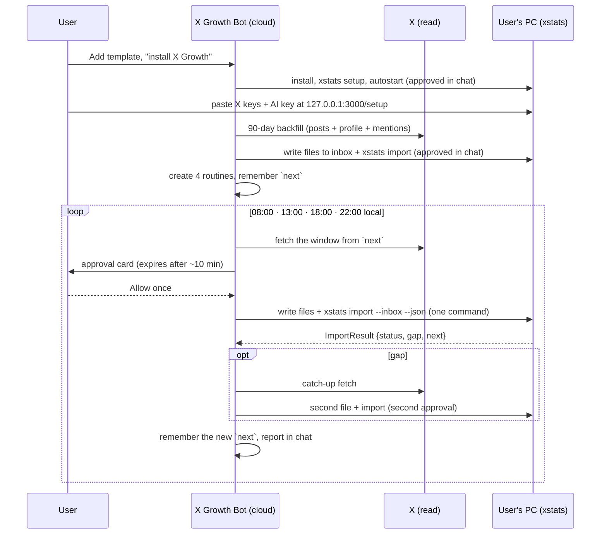

# X Growth Bot: the Grok Bot pack

The **X Growth Bot** is a Grok Bot ([x.ai/bot](https://x.ai/bot)) that installs X Growth on the
user's computer, reads their X data and drops it into the app several times a day. This folder is
everything the bot needs, written so it can be pasted into Grok Bot as is, plus the guides for
publishing it and for testing it.

Plan and contract: [ARCHITECTURE.md](../ARCHITECTURE.md) sections 4, 5, 6 and 13, and the types in
[`lib/contract/envelope.ts`](../../lib/contract/envelope.ts).

| File | What it is | Who uses it |
|---|---|---|
| [instructions.md](instructions.md) | The bot's standing rules, ready to paste into the bot's instructions | Bot author |
| [skills/](skills/) | One file per skill, each ready to save as a Grok Bot skill | Bot author, and the bot itself (self-repair) |
| [routines.md](routines.md) | The 4 daily routines and the optional webhook "Sync now" routine | The install skill, bot author |
| [template.md](template.md) | How to publish the bot as a shared template link | Bot author |
| [user-guide.md](user-guide.md) | Plain-English onboarding and troubleshooting | End users |
| [spikes.md](spikes.md) | Test scripts and result templates for spikes S1–S5 and S8 | Bot author, before release |

Also part of this workstream:

- [`scripts/simulate-bot.ts`](../../scripts/simulate-bot.ts) (`bun run simulate-bot`): turns a raw
  X API export into envelope files in `data/inbox/`, exactly as the bot would, so the app can be
  tested without Grok Bot.
- [`fixtures/envelopes/`](../../fixtures/envelopes/): synthetic valid and invalid envelope files.

> **Names.** ARCHITECTURE.md section 6.4 calls the skills `install-xstats` and `xstats-*`. They are
> named `install-xgrowth` and `xgrowth-*` here, after the product name (X Growth, `APP_NAME` in
> `lib/app.ts`). The CLI keeps its name, `xstats`.

---

## How it works, end to end



1. **Install.** The user adds the bot from the template link and says "install X Growth". The
   [`install-xgrowth`](skills/install-xgrowth.md) skill asks for the handle, timezone and reminder
   times, installs the app, runs `xstats setup` and `xstats autostart enable`, and opens
   `http://127.0.0.1:3000/setup`, where the user pastes their keys. The bot never sees them.
2. **Backfill.** [`xgrowth-backfill`](skills/xgrowth-backfill.md) reads the last 90 days of posts,
   the profile and recent mentions, writes them as envelope files of at most 1,000 posts each, and
   imports them.
3. **Routines.** The install skill creates four routines (08:00, 13:00, 18:00, 22:00 in the user's
   timezone) that run [`xgrowth-sync`](skills/xgrowth-sync.md), and offers an optional webhook
   routine for the app's **Sync now** button. See [routines.md](routines.md).
4. **Each sync.** The bot reads X in its own cloud (no approval), then asks for **one** approval
   to run a single command on the PC that writes the files into the inbox and runs
   `xstats import --inbox --json`. The app answers with an `ImportResult`. The bot handles a `gap`
   with a catch-up fetch (a second approval) and remembers `next` for the following run.
5. **Missed runs.** If the approval expires, the PC is off or the app isn't running, the bot reports
   the run as skipped and keeps its old `next`. The next run's window starts from the last
   successful import, so nothing is lost; it just costs more reads.
6. **Upkeep.** [`xgrowth-update`](skills/xgrowth-update.md) runs `xstats update`;
   [`xgrowth-doctor`](skills/xgrowth-doctor.md) runs `xstats doctor --json` and explains problems.
   [`xgrowth-inspiration`](skills/xgrowth-inspiration.md) is a Phase 5 draft.

## What lives in the template, and what lives in the app

Grok Bot templates copy a bot's instructions, relevant memories, skills, routines and some plugins.
They **exclude custom code and scripts, private skills, non-standard plugins (MCP servers) and
secrets** ([templates guide](https://x.ai/bot/guides/templates-for-grok-bot)). So the template holds
only words, and every piece of logic that has to be exact lives in the app.

| In the template (words) | In the app (code) |
|---|---|
| Standing rules ([instructions.md](instructions.md)) | Envelope validation, size and account checks |
| Skills: which X endpoints and fields to read, how to page, slice and chunk, how to write files, which `xstats` command to run, what to report | Field mapping from raw X objects to rows (the bot never reshapes data) |
| Routine prompts (created by the install skill, because routines may not survive templating: spike S3) | Sync windows: `last_ok_to`, `gap` and `next` (the bot only follows them) |
| Where to find everything else: this repo, which is public | Install, autostart, update, backups (`xstats` commands and the installer) |
| | Keys (`data/secrets.json`) and every call that uses them |

Because skills might not be copied with the template (they may count as private skills), the
instructions tell the bot to re-create any missing skill from this folder on GitHub
(`https://raw.githubusercontent.com/karthi-98/x-growth/main/docs/grok-bot/skills/<name>.md`).

## The bot's state

The bot keeps a small state object in its memory **and** mirrors it to
`/workspace/x-growth/state.json` on its own cloud computer (the documented place for durable
files), so routine runs can read it even if memory isn't shared with them (spike S2 checks this).

```json
{
  "account": { "id": "1000000000000000001", "username": "xgrowth_demo" },
  "timezone": "Asia/Kolkata",
  "os": "windows",
  "cli": "xstats",
  "inbox": "C:\\Users\\me\\AppData\\Local\\XStats\\data\\inbox",
  "next": { "type": "light", "from": "2026-10-24T06:30:00Z", "mentionsSinceId": "1849900000000000000" },
  "next_saved_at": "2026-10-24T07:31:05Z",
  "last_run": { "id": "rl3c7d", "at": "2026-10-24T07:31:05Z", "status": "ok" }
}
```

It never holds keys, post text or metrics. Those only pass through the bot on their way to the
inbox.

## The `xstats` commands the bot relies on

The **sync** and **runtime** workstreams build these. This is what the skills assume; if a command
or field changes, update the skills in the same PR.

| Command | Used by | The bot reads |
|---|---|---|
| `xstats setup --handle <h> --user-id <id> --timezone <IANA> [--reminders 08:00,13:00,18:00,22:00] --json` | install | `status`, `paths.inbox` |
| `xstats autostart enable --json` | install | `status` |
| `xstats start` | install, doctor fixes | starts the web app and worker (it keeps running) |
| `xstats status --json` | install, sync preflight in chat | `version`, `paths.inbox`, app running or not |
| `xstats import --inbox --json` | backfill, sync | `ImportResult` from `lib/contract/envelope.ts` |
| `xstats plan --json` | inspiration, debugging | `next` (same as `ImportResult.next`) |
| `xstats doctor --json` | doctor | `status`, a list of checks with plain-language fixes |
| `xstats update --json` | update | `status`, old and new version |

Every `--json` command prints exactly one JSON object and exits non-zero on failure with
`{ "status": "failed", "error": "…" }` (`cli/util.ts`).

What the bot needs from the import, beyond the types:

- **Ignore files that don't end in `.json`.** The bot writes `<name>.json.part` and renames it, so
  the worker never imports a half-written file.
- **Accept UTF-8 with or without a BOM.**
- **Fill `next` (and `gap`) even when `status` is `"empty"`.** The worker may import the bot's files
  a moment before the bot's own `xstats import` runs; the bot still needs `next`.
- **Treat a run id plus kind as unique.** The posts file and the mentions file of one run share the
  run id. Backfill chunks get their own ids (`<runId>-01`, `-02`, …, oldest first), so a plain sort
  by file name imports them oldest first.

## Envelope files, in one paragraph

Each file is an `ExportEnvelope` (version 1) holding **raw X API v2 objects, never reshaped**. The
name is `<kind>-<UTC yyyyMMddTHHmmssZ>-<runId>.json`, where the timestamp is the run's start
(e.g. `posts-20261024T073000Z-rl3c7d.json`). A file holds at most 1,000 posts. `window` is
`[start_time, end_time)` in UTC. `complete: false` plus `rate_limited: true` means the bot stopped
at a read limit; the data is still imported, but the app doesn't count the window as covered.
Details, with examples: [skills/xgrowth-sync.md](skills/xgrowth-sync.md) and
[fixtures/envelopes/](../../fixtures/envelopes/README.md).

## Known unknowns

These are open until the spikes in [spikes.md](spikes.md) are run:

- **S1, file delivery.** The Grok Bot docs don't describe sending a file to the user's computer.
  The skills write files with a single approved shell command (a here-string or heredoc). The
  spike measures how large that command can be and how many approvals a run causes.
- **S2, X reads.** Whether routine runs get the same raw JSON, how many reads fit in the
  allowance, what the limit looks like, and whether the user-timeline endpoint's documented cap of
  the **3,200 most recent posts** applies. A 90-day backfill for an account posting ~68 times a day
  is ~6,100 posts, so the backfill skill falls back to full-archive search
  (`GET /2/tweets/search/all`) for older slices if the timeline comes back empty.
- **S3, templates** keeping skills and routines. **S4, approvals** from the phone and their expiry.
  **S5, the webhook** body and start time. **S8, the pause** after inactivity.
